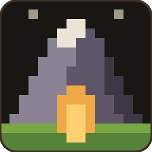

<p align="center"></p>

<h1 align="center">Colony Game</h1>
<p align="center"><b>dig deep · build big · grow a people</b></p>

A 3D colony simulation in the spirit of Dwarf Fortress. Lead a small colony into the mountains: hollow out the rock,
raise homes and workshops, and grow long chains of industry, from logs and stone to clockwork and aether. Play alone,
hot-seat, or online with friends, each of you a colony in one shared world: trade, cooperate, or compete.

> Early development: expect rough edges, and saves that may not survive every update.

## Play

1. Download **[ColonyLauncher.exe](https://github.com/Quaffio69/Colony-Game/releases/latest/download/ColonyLauncher.exe)**
   (Windows 10 or 11, 64-bit).
2. Run it and press **Install**. It installs the game for you (no administrator rights), adds a Start menu entry, and
   from then on checks for updates each time you open it: **Update**, then **Play**.

Windows may warn that the launcher is from an unknown publisher (it isn't code-signed yet): choose
**More info → Run anyway**. Every download is checked against its published SHA-256 before it is installed.

Your saves and settings live in `%APPDATA%\Godot\app_userdata\Colony Game` and are kept through updates and uninstalls.
Uninstall from the launcher, or from Windows' **Apps & features**.

Prefer no launcher? Each [release](https://github.com/Quaffio69/Colony-Game/releases) also has the game as a zip: unpack it anywhere
and run `ColonyGame.exe`.

**Requirements:** a graphics card with Vulkan support (most from 2016 on); 4 GB of RAM; about 200 MB of disk.

### Getting started

- **F3** lists every key. The mouse: drag with the right button to pan, the wheel to zoom, the left button to move
  between levels; click anything to inspect it.
- **B** opens Build: zone a stockpile, chop trees, dig into the hillside, paint a home and furnish it.
- **J** sets who does what; **C** shows your colonists; **L** is the chronicle of what happened.
- **Multiplayer** (main menu): one player hosts (their router must forward the port, 7777 by default), the others join
  by address. Everyone needs the same version: the launcher keeps you on the newest.
- **F6** trades with other colonies: offer, counter, accept; traders carry the goods to each other's trade depot.

## Building from source

- [Godot 4.7.2 .NET](https://godotengine.org/download) and the [.NET 8 SDK](https://dotnet.microsoft.com/download).
- Open `game/project.godot` in Godot and press Play, or from a terminal:
  `dotnet build ColonyGame.sln`, `dotnet test ColonyGame.sln`.
- The simulation (`src/Colony.Core`) is plain .NET with no Godot dependency; `game/` is the Godot front end;
  `launcher/` is the launcher (WPF, .NET Framework 4.8); `tools/Colony.Bench` has headless benchmarks.
- Design and architecture: `docs/design/` (one file per system), `docs/roadmap.md`; `CLAUDE.md` is the short version for AI-assisted work.

## Releasing

Tag a version and push the tag; the **Release** workflow does the rest (tests, export, zip, checksum, launcher, GitHub
release):

```
git tag -a v0.3.0 -m "What's new in this version (shown in the launcher)"
git push origin v0.3.0
```

A tag with a hyphen (`v0.3.0-beta`) makes a pre-release that launchers don't offer. Release notes can be edited on
GitHub afterwards; the launcher shows the current text. Bump `Lockstep.Protocol` whenever the simulation changes, so
players on different versions get a clear message instead of a desync.

## License

[MIT](LICENSE). Third-party software and fonts: see [THIRD_PARTY_NOTICES.md](THIRD_PARTY_NOTICES.md).
